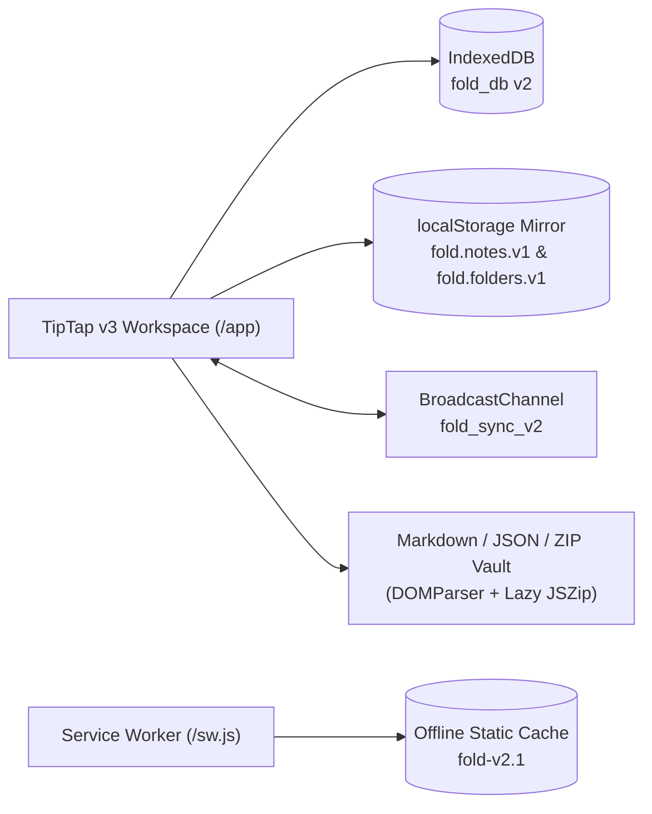

<div align="center">


<h1>Fold</h1>

<p><strong>Notes, without the noise.</strong></p>

<p>
  A quiet, local-first notes workspace and installable Progressive Web App (PWA) for the web.<br />
  Everything lives exclusively on your device in IndexedDB — zero tracking, zero cookies, zero accounts.
</p>

<p>
  <a href="https://foldnotes.web.app"></a>
  <a href="https://foldnotes.web.app/app"></a>
  
  
  
  
  <a href="./LICENSE"></a>
</p>

<p>
  <a href="#-features">Features</a> •
  <a href="#-architecture">Architecture</a> •
  <a href="#-quickstart">Quickstart</a> •
  <a href="#%EF%B8%8F-routes--structure">Routes</a> •
  <a href="#%EF%B8%8F-keyboard-shortcuts">Shortcuts</a> •
  <a href="#%EF%B8%8F-security--privacy">Security</a> •
  <a href="#-production-verification">Verification</a>
</p>

</div>

---

## ✨ Features

| Capability | What It Does |
| --- | --- |
| **Local-First Engine** | Sub-millisecond commits to IndexedDB (`fold_db` v2) with automatic `localStorage` recovery (`fold.notes.v1`) and durable storage pinning (`navigator.storage.persist()`). |
| **Real-Time Tab Sync** | Cross-tab `BroadcastChannel` (`fold_sync_v2`) keeps notes, folders, and edits synchronized across open windows with zero network requests. |
| **TipTap v3 Rich Editor** | Headings, interactive checklists, code blocks, highlights, note locking, pinning, and distraction-free Zen Mode (<kbd>⌘</kbd><kbd>.</kbd>). |
| **Portable Vault Exports** | Bidirectional CommonMark/GFM import and export — single `.md`, full `.json` workspace backup, or folder-organized `.zip` archive (lazy-loaded `JSZip`). |
| **Offline-Ready PWA** | Service Worker (`/sw.js`) with network-first document navigation, static asset caching, and self-hosted fonts (`Instrument Sans` & `JetBrains Mono`). |
| **Paper & Ink Themes** | Warm **Paper** (`#f4f0e6`) and dark **Ink** (`#141511`) stationery themes with View Transitions, WCAG AA contrast, reduced-motion support, and optional Web Audio feedback. |

---

## 🧱 Architecture



### Tech Stack

| Layer | Technology | Implementation Details |
| --- | --- | --- |
| **Framework** | Next.js `16.4.5` (App Router, Turbopack) | `output: "export"` pure static build (`out/`) for Firebase Hosting |
| **UI & Language** | React `19.3`, TypeScript `5`, Tailwind CSS `4` | Strict `tsc --noEmit` + ESLint |
| **Editor** | TipTap `3.33` | StarterKit, TaskList, TaskItem, Highlight, Placeholder |
| **Storage & Sync** | IndexedDB + `localStorage` + `BroadcastChannel` | Indexed `notes` store (`updated`, `folder`) + multi-tab IPC |
| **Typography** | `next/font/google` (self-hosted) | `Instrument Sans` & `JetBrains Mono` (zero external font CDNs) |
| **Testing** | Node.js built-in test runner | `node --test "src/**/*.test.ts"` (zero extra test dependencies) |

---

## 🚀 Quickstart

> **Prerequisites:** Node.js `>= 20` (tested on Node `24`) and `pnpm`.

```bash
# 1. Install dependencies
pnpm install

# 2. Configure public environment variables
cp .env.example .env.local

# 3. Start the development server
pnpm dev
```

Open [http://localhost:3000](http://localhost:3000) for the landing page and interactive preview, or [http://localhost:3000/app](http://localhost:3000/app) for the full workspace.

### Available Scripts

| Command | Description |
| --- | --- |
| `pnpm dev` | Start Next.js development server |
| `pnpm build` | Create optimized production build |
| `pnpm start` | Serve production build locally |
| `pnpm lint` | Run ESLint across the repository |
| `pnpm typecheck` | Run TypeScript compiler check (`tsc --noEmit`) |
| `pnpm test` | Run unit tests (`node --test "src/**/*.test.ts"`) |

---

## 🗺️ Routes & Structure

### Application Routes

| Route | Mode | Purpose |
| --- | --- | --- |
| `/` | Static | Landing page, interactive 3-pane demo, architecture specs, and FAQ |
| `/app` | Static (Client Shell) | Full distraction-free workspace & PWA `start_url` (`noindex`) |
| `/blog` | Static | Field Notes essays index |
| `/blog/[slug]` | SSG / Partial Prerender | MDX articles with TOC, code blocks, and dynamic OG images |
| `/privacy`, `/terms` | Static | Client storage inventory & MIT usage terms |
| `/api/health` | Dynamic (`GET`) | Liveness probe returning `{ status, timestamp }` (`Cache-Control: no-store`) |
| `/robots.txt`, `/sitemap.xml` | Static | Search crawler rules and canonical URL index |

<details>
<summary><strong>📁 Project Structure</strong> (click to expand)</summary>

```text
public/
├── llms.txt              # Concise LLM product & architecture reference
├── llms-full.txt         # Extended technical specification
├── manifest.webmanifest  # PWA install manifest (/app start URL)
└── sw.js                 # Offline Service Worker & asset cache
src/
├── app/
│   ├── api/health/       # Liveness health check endpoint (/api/health)
│   ├── app/              # /app workspace route, loading skeleton & error boundary
│   ├── blog/             # Field Notes blog & MDX article routes
│   ├── privacy/          # Privacy policy & storage key inventory
│   ├── terms/            # Terms of use
│   ├── error.tsx         # Route-segment error boundary
│   ├── global-error.tsx  # Root layout error boundary
│   ├── page.tsx          # Landing page & interactive showcase
│   ├── robots.ts         # Dynamic robots.txt
│   └── sitemap.ts        # Dynamic sitemap.xml
├── components/
│   ├── FoldWorkspace.tsx # Interactive landing-page workspace preview
│   ├── IslandNavbar.tsx  # Floating top navigation bar
│   ├── blog/             # Blog listing, Markdown renderer, TOC & code blocks
│   ├── landing/          # Landing page sections & footer
│   ├── wensity/          # Shared UI primitives (kbd, label, select, buttons)
│   └── workspace/        # Full TipTap editor, sidebar, note list & modals
├── content/blog/         # MDX essays
├── lib/
│   ├── storage/          # IndexedDB engine, Markdown/ZIP export, sync & unit tests
│   ├── audio-haptics.ts  # Synthesized Web Audio micro-haptics
│   ├── blog.ts           # Server-only MDX/MD blog loader
│   ├── blog-shared.ts    # Client-safe blog types & heading helpers
│   ├── site.ts           # Site metadata, URL validation & theme tokens
│   └── use-theme.ts      # Paper / Ink theme hook
└── types/
    └── note.ts           # Note schema, sort modes & default folders
```

</details>

---

## ⌨️ Keyboard Shortcuts

> Replace <kbd>⌘</kbd> with <kbd>Ctrl</kbd> and <kbd>⌥</kbd> with <kbd>Alt</kbd> on Windows and Linux.

| Shortcut | Scope | Action |
| --- | --- | --- |
| <kbd>⌘</kbd><kbd>K</kbd> | Global / Editor | Open Command Palette (or insert/edit link when text is selected or caret is in a link) |
| <kbd>/</kbd> | Global | Focus workspace search bar (outside text inputs/dialogs; <kbd>Esc</kbd> clears & blurs) |
| <kbd>N</kbd> / <kbd>⌥</kbd><kbd>⇧</kbd><kbd>N</kbd> | Global | Create a new note (<kbd>N</kbd> outside text inputs) |
| <kbd>⌘</kbd><kbd>S</kbd> | Global | Save immediately to IndexedDB |
| <kbd>⌘</kbd><kbd>.</kbd> | Global | Toggle full-screen Zen mode (<kbd>Esc</kbd> exits) |
| <kbd>⌘</kbd><kbd>P</kbd> | Global | Pin or unpin selected note |
| <kbd>⌘</kbd><kbd>D</kbd> | Global | Duplicate selected note |
| <kbd>⌘</kbd><kbd>\\</kbd> | Global | Toggle sidebar |
| <kbd>⌥</kbd><kbd>⇧</kbd><kbd>L</kbd> | Global | Lock or unlock selected note |
| <kbd>T</kbd> | Global | Toggle Paper / Ink theme (outside text inputs) |
| <kbd>⌘</kbd><kbd>/</kbd> | Global / Editor | Show or hide the floating formatting dock (when a note is active) |

<details>
<summary><strong>✍️ Rich-Text Editor Shortcuts</strong> (click to expand)</summary>

| Shortcut | Scope | Action |
| --- | --- | --- |
| <kbd>⌘</kbd><kbd>B</kbd> / <kbd>⌘</kbd><kbd>I</kbd> | Editor | Bold / Italic |
| <kbd>⌘</kbd><kbd>⌥</kbd><kbd>1</kbd> / <kbd>2</kbd> / <kbd>3</kbd> | Editor | Toggle Heading (`H1` / `H2` / `H3`) |
| <kbd>⌘</kbd><kbd>⇧</kbd><kbd>8</kbd> | Editor | Bullet list |
| <kbd>⌘</kbd><kbd>⇧</kbd><kbd>7</kbd> | Editor | Numbered list |
| <kbd>⌘</kbd><kbd>⇧</kbd><kbd>9</kbd> | Editor | Interactive task checklist |
| <kbd>⌘</kbd><kbd>⇧</kbd><kbd>Y</kbd> | Editor | Highlight text |
| <kbd>⌘</kbd><kbd>Z</kbd> / <kbd>⌘</kbd><kbd>⇧</kbd><kbd>Z</kbd> | Editor | Undo / Redo |

</details>

---

## ⚙️ Environment Variables

All runtime variables are public (`NEXT_PUBLIC_*`) and optional — fallback defaults are defined in [`src/lib/site.ts`](./src/lib/site.ts). See [`.env.example`](./.env.example):

| Variable | Default | Purpose |
| --- | --- | --- |
| `NEXT_PUBLIC_SITE_URL` | `https://foldnotes.web.app` | Canonical origin for metadata, Open Graph URLs, and `sitemap.xml` |
| `NEXT_PUBLIC_SUPPORT_EMAIL` | `support.dhairyadarji@gmail.com` | Public contact address shown in footer, FAQ, and legal pages |
| `NEXT_PUBLIC_GITHUB_URL` | `https://github.com/dhairya0707/fold` | Public GitHub repository URL linked from the landing page |

---

## 🛡️ Security & Privacy

- **Zero Server Persistence:** Notes never leave the browser. No cookies, telemetry SDKs, or external font/CDN requests are used.
- **Strict HTTP Headers:** [`next.config.ts`](./next.config.ts) enforces `Content-Security-Policy` (`connect-src 'self'`, `frame-ancestors 'none'`, `object-src 'none'`), `Strict-Transport-Security`, `X-Frame-Options: DENY`, `X-Content-Type-Options: nosniff`, `Referrer-Policy`, and `Permissions-Policy`.
- **Sanitized Imports & Links:** HTML/Markdown parsing uses inert `DOMParser` documents, 10 MB import size caps, explicit schema validation, YAML frontmatter escaping, and strict `http:` / `https:` / `mailto:` / single-slash relative URL checks.

For full security boundaries or reporting issues, see [`SECURITY.md`](./SECURITY.md).

---

## ✅ Production Verification

Run the full verification suite before deploying:

```bash
pnpm lint && pnpm typecheck && pnpm test && pnpm build
```

After starting the production server (`pnpm start`):

- `GET /api/health` returns `200 OK` with `Cache-Control: no-store`.
- `GET /sw.js` returns `Cache-Control: no-cache, no-store, must-revalidate` so deployments update cleanly.

---

## 🤝 Contributing, Changelog & License

- **Contributing:** Read [`CONTRIBUTING.md`](./CONTRIBUTING.md) before opening a pull request.
- **Changelog:** Track release notes in [`CHANGELOG.md`](./CHANGELOG.md).
- **License:** Released under the [MIT License](./LICENSE).

<div align="center">
  <br />
  <sub>Built by <a href="https://x.com/dhairya0707">Dhairya Darji</a> · Local-first, private by architecture.</sub>
</div>
